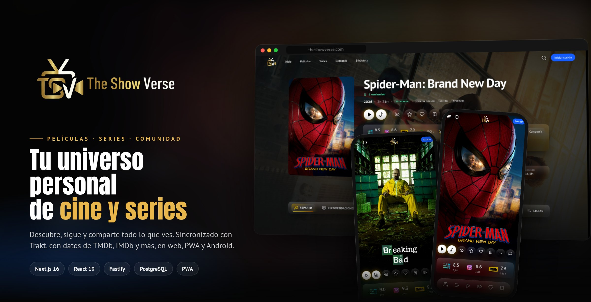
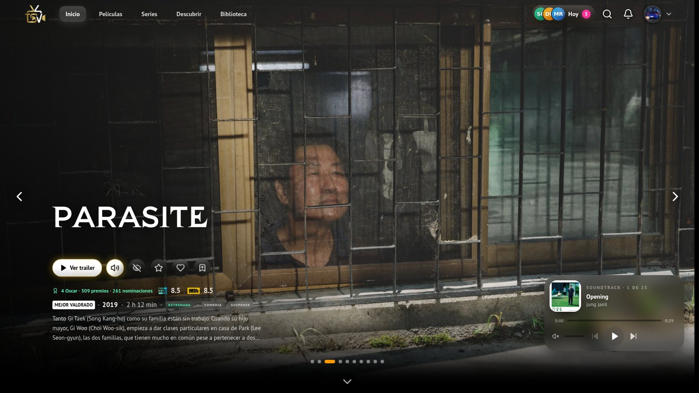
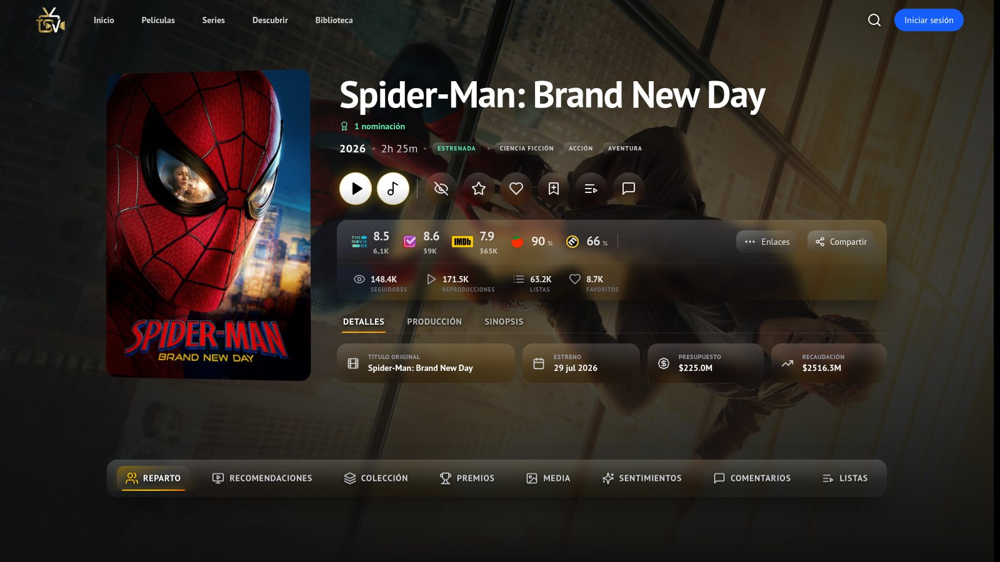
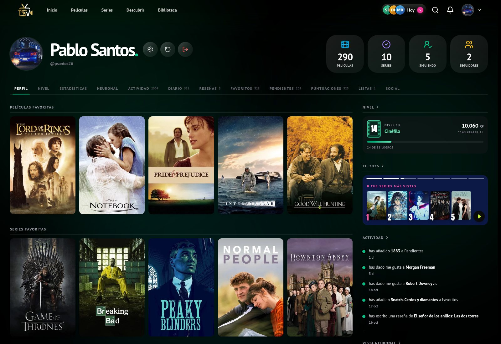
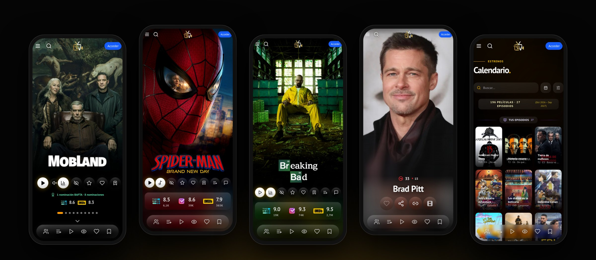
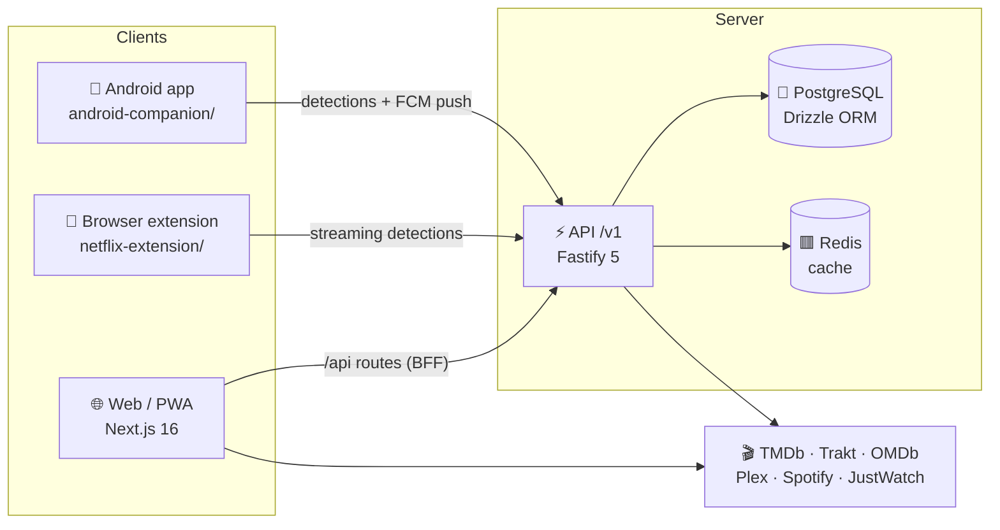

<div align="center">

<a href="https://theshowverse.com">
  
</a>

<br>
<br>

**English** · [Español](README.md)

<br>

**Discover, track and share everything you watch.**<br>
Movies, shows, seasons and episodes in one place, with your lists, your history, your community and your streaming services kept in sync.

<br>

[](https://theshowverse.com)
[](docs/README.md)
[](LICENSE)

<br>


</div>

---

## 🎯 What it is

What you watch is scattered across Netflix, Max, Disney+, Prime Video, Crunchyroll… **The Show Verse** brings it together in one carefully crafted app:

| 🔍 Discover | 📺 Track | 🗂️ Organise | 💬 Share |
|---|---|---|---|
| Curated dashboards, its own recommendation engine and filtered search | History, per-episode progress, "continue watching" and a release calendar | Favourites, watchlist, custom lists and collections | Public profiles, reviews, daily stories and a yearly recap |

The interface is in Spanish today; the code, the architecture and these contribution docs are open to everyone.



<table>
<tr>
<td width="50%"><p align="center"><sub><b>Movie page</b> with ratings from 8+ sources</sub></p></td>
<td width="50%"><p align="center"><sub><b>Public profile</b> with levels and activity</sub></p></td>
</tr>
</table>



More screenshots in the [visual tour](README.md#-tour-visual) of the Spanish README.

---

## ✨ Features

- **Catalogue**: pages for movies, shows, seasons, episodes and people; ratings from TMDb, Trakt, IMDb, Rotten Tomatoes, Metacritic and more; trailers, soundtracks and where to watch.
- **Tracking**: watch history and per-episode progress, your own 0–10 ratings, a personal release calendar and viewing statistics.
- **Library**: favourites and watchlist with several views and advanced filters, custom lists, import from Trakt, TMDb, IMDb and Letterboxd, data export and Plex integration.
- **Social**: public profiles and followers, daily stories, reviews with sentiment analysis, "your friends" on every title, and shareable images.
- **Gamification**: levels, XP, ranks, streaks, 38 achievements and a yearly recap.
- **AI assistant**: ask in plain language ("a short Korean thriller on Netflix") and get filtered recommendations.
- **Experience**: installable PWA with offline mode, web and Android push notifications, and automatic streaming sync through a browser extension and an Android app.

---

## 🌌 Ecosystem



| Piece | What it does | Where |
|---|---|---|
| 🌐 **Web and PWA** | The full app, installable and usable offline | [`src/`](src) |
| ⚡ **Backend** | Accounts, library, community, levels, recap and push | [`backend/`](backend) |
| 🧩 **Extension** | Detects what you watch on Netflix, Prime Video, Max, Disney+, Crunchyroll… | [`netflix-extension/`](netflix-extension) |
| 🤖 **Android app** | Playback detection on the phone and notifications | [`android-companion/`](android-companion) |

**Stack:** Next.js 16 (App Router, RSC), React 19, Tailwind CSS 4, Framer Motion · Fastify 5, Zod, PostgreSQL with Drizzle ORM, Redis · Vercel, Docker on a self-hosted NAS behind Cloudflare Tunnel, GitHub Actions.

---

## 🚀 Getting started

You need **Node.js 22+**, **Docker Engine** with **Docker Compose v2**, and a [TMDb API key](https://www.themoviedb.org/settings/api) (Google, Trakt, OMDb and Spotify keys are optional).

```bash
git clone https://github.com/Psantoss26/the-show-verse.git
cd the-show-verse
npm ci
npm --prefix backend ci
cp .env.example .env
cp backend/.env.example backend/.env
npm run local:setup
```

Fill in the keys in `.env` and `backend/.env`, then start the web app and the API in two terminals:

```bash
npm run dev
```

```bash
npm --prefix backend run dev
```

The web app runs on http://localhost:3000 and the API on http://localhost:3001. The backend starts PostgreSQL and Redis in Docker and applies the migrations.

---

## 📚 Documentation

[`docs/`](docs/README.md) is an Obsidian vault (in Spanish): features, frontend pages and components, backend API reference, architecture and infrastructure. Recent changes are in the [changelog](CHANGELOG.md).

---

## 🤝 Contributing

Contributions are welcome, in English or Spanish. Read [CONTRIBUTING.md](CONTRIBUTING.md) to set up the project and open your first pull request, and look for issues labelled [`good first issue`](../../issues?q=is%3Aissue+is%3Aopen+label%3A%22good+first+issue%22). Everyone is expected to follow the [Code of Conduct](CODE_OF_CONDUCT.md). Security problems go through [SECURITY.md](SECURITY.md).

---

## 📄 License

The code is licensed under the [GNU Affero General Public License v3.0 or later](LICENSE). You can use, study, modify and share it; if you run a modified version as a public service, you must publish your changes under the same license.

Logos, names and data from third-party services (TMDb, Trakt, IMDb, streaming platforms…) belong to their owners and are not covered by this license. This product uses the TMDb API but is not endorsed or certified by TMDb.

---

<div align="center">

Made by [Psantoss26](https://github.com/Psantoss26) · ⭐ Star the project if you like it

</div>
